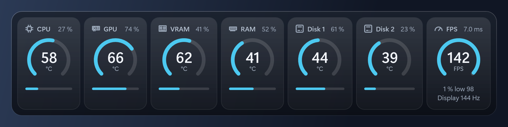
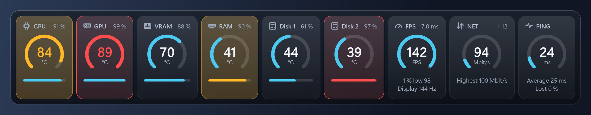
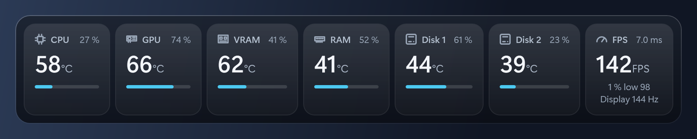
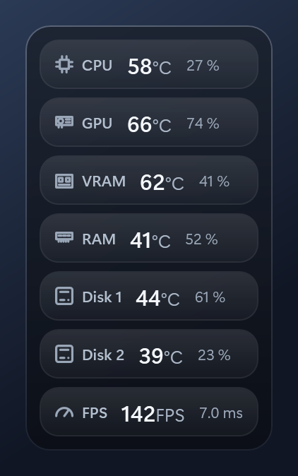
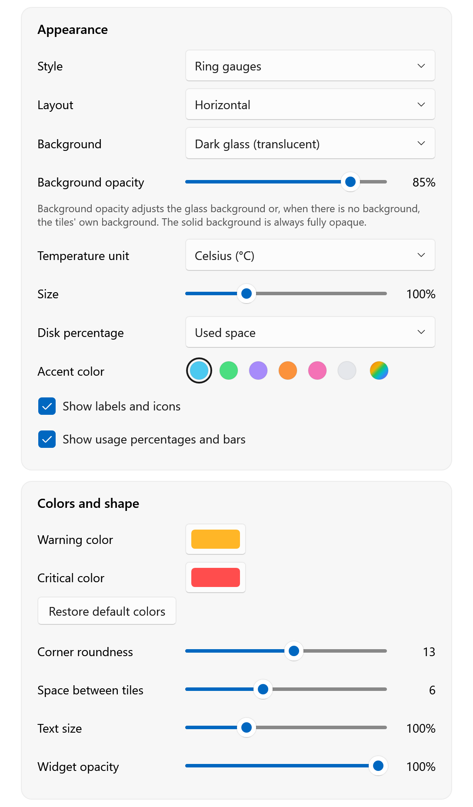
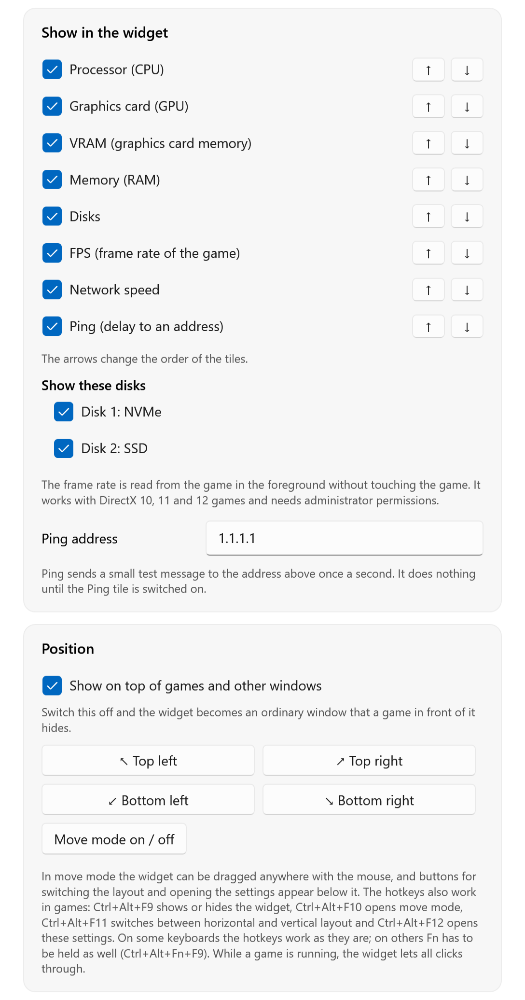
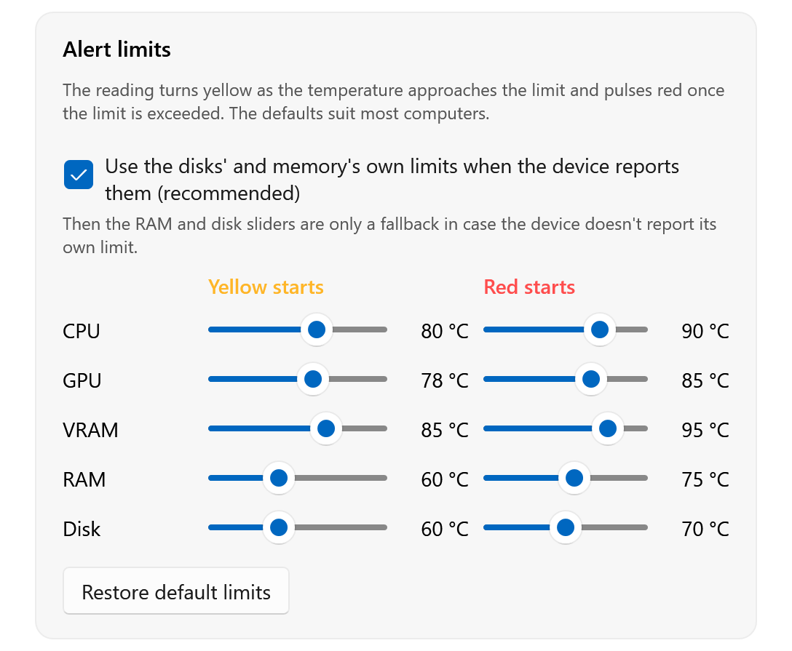

# FrameHeat

[](https://github.com/paulakarhi/FrameHeat/releases/latest)
[](LICENSE)

A small, free FPS counter and hardware monitor for Windows 11. It shows the temperature and load of the CPU,
graphics card, video memory, RAM and every disk, together with the frame rate of the game you are playing, in a panel
that stays on top of games and other windows. A reading turns yellow as the temperature nears its limit and pulses
red once the limit is passed.

Nothing else has to be installed or configured: no HWiNFO, no MSI Afterburner, no RTSS. The defaults work as
they are; the settings window only adjusts the look.

## Screenshots

The ring gauges, the default design. The FPS tile shows the frame rate, the time between frames, the one percent
low and the refresh rate of the monitor.



A tile turns yellow as its temperature nears the limit and red once the limit is passed. Both colors can be changed.



The compact design, and a text row per device laid out vertically:





The settings window: the look, which tiles to show and where, and the alert limits.





## Features

- Tiles for CPU, GPU (core temperature), VRAM (memory temperature and fill level), RAM (when the modules have a
  temperature sensor), each disk and the frame rate, showing temperature and load or fill level (%)
- Frame rate (FPS) of the program in the foreground, with the time between frames, the one percent low and the
  refresh rate of the monitor. It is read from Windows' own event tracing, the source PresentMon uses, so nothing
  is injected into the game.
- Three designs: ring gauges (the ring fills as the temperature approaches the red limit), compact (large number and
  bar) and a text row (one line per device)
- Yellow and red alerts. Disks and memory report their own limit, and the red alert starts there with yellow 8 °C
  earlier; CPU and GPU use built-in defaults (CPU 80/90, GPU 78/85, VRAM 85/95 °C). All limits can be edited.
- No flicker at a limit: a tile returns to normal only after the temperature has fallen 2 °C below it
- Memory and disk usage alert as well (over 85 % yellow, over 95 % red)
- Temperatures in °C or °F. Alert limits are stored in °C and shown in the chosen unit.
- Always on top, never takes focus, and mouse clicks pass through to the game. A setting turns the on-top
  behavior off, so the widget becomes an ordinary window that a game in front of it hides.
- Stays on screen while dragged; changing the layout or size keeps the widget attached to the screen edge it was closest to
- Look: horizontal or vertical, size, text size, panel style and opacity, widget opacity, corner roundness, space
  between tiles, accent color (a choice of six or any color), own colors for the yellow and red alerts, labels and
  usage on or off, snap to a corner or drag anywhere
- Choose which tiles to show, in which order, and which disks
- Hotkeys that also work in games: **Ctrl+Alt+F9** show/hide, **Ctrl+Alt+F10** move mode, **Ctrl+Alt+F11** switch
  layout, **Ctrl+Alt+F12** settings. On some keyboards the hotkeys work as they are; on others **Fn** has to be held as
  well (for example Ctrl+Alt+Fn+F9), or Fn Lock switched on.
- Tray icon with the same actions, a demo mode for trying the alert colors, and diagnostics export
- Start with Windows through a scheduled task, so there is no UAC prompt at every boot. It is asked once on the first run.
- Ten languages: English, Suomi, Svenska, Deutsch, Français, Español, Português (Brasil), 中文（简体）, 日本語 and 한국어.
  The language is chosen in the installer, not in the settings.

## Requirements

- Windows 11, 64-bit. Windows 10 has not been tried.
- Administrator rights. The CPU, memory and disk sensors and the frame rate cannot be read without them, so the
  program asks for elevation each time it is started by hand.

## Installing

Download `FrameHeat-Setup-<version>.exe` from the [latest release](https://github.com/paulakarhi/FrameHeat/releases/latest)
and run it, or build the installer from source (below). The first page asks for the language. The installer

- copies the program to `Program Files\FrameHeat` and adds a Start menu entry,
- stores the chosen language in `HKLM\Software\FrameHeat`, value `Language` (for example `fi`),
- installs the PawnIO driver silently if it is not on the machine yet. Windows exposes CPU and memory temperatures
  only through a driver. PawnIO is signed, so no test-signing mode is needed.

The installer is not code-signed, so Windows SmartScreen may warn about it.

Uninstalling removes the program, its Start menu entry and the start-up task. The settings in `%APPDATA%\FrameHeat`
and the driver stay.

The program reads the language from the registry at start. Without the value (for example a bare `.exe`) it follows
the Windows display language, and falls back to English. `--lang <code>` overrides both.

The Simplified Chinese installer shows English wizard text, because Inno Setup has no official Chinese translation.
The program itself is translated.

## Building

Requires the .NET 9 SDK.

```powershell
dotnet build FrameHeat.sln
dotnet run --project src/FrameHeat -- --demo     # synthetic readings, to see yellow and red without heating the machine
.\scripts\dev-admin.ps1                          # the debug build elevated, so all sensors work
.\scripts\publish.ps1                            # dist\FrameHeat.exe, one self-contained file
.\scripts\build-installer.ps1                    # dist-installer\FrameHeat-Setup-<version>.exe
.\scripts\make-icon.ps1                          # redraws src\FrameHeat\Assets\app.ico (only needed when the icon changes)
```

The installer script also needs Inno Setup 6 (`winget install JRSoftware.InnoSetup`). On first use it downloads the
PawnIO driver setup from <https://github.com/namazso/PawnIO.Setup/releases> and checks it against a pinned SHA-256 hash.

Without administrator rights (`dotnet run`) the GPU temperature and the loads are shown, but CPU, disk and memory
temperatures and the frame rate are missing.

### Command-line options

| Option | Effect |
| --- | --- |
| `--demo` | synthetic readings |
| `--edit` | start in move mode |
| `--settings` | open the settings window |
| `--dump <file>` | write a hardware report and exit, without any window |
| `--lang <code>` | use a language (`en fi sv de fr es pt zh ja ko`) |
| `--settings-file <file>` | use another settings file |
| `--multi` | allow a second instance |
| `--autostart` | passed by the start-up task |

Settings are stored in `%APPDATA%\FrameHeat\settings.json`; the log and the diagnostics report are in
`%LOCALAPPDATA%\FrameHeat`.

## Project layout

```
src/FrameHeat.Core     Platform-neutral logic, no Windows dependencies
  Alerts/              limits, defaults, limit resolution, hysteresis
  Metrics/             readings, snapshots, frame rate figures, temperature units
  Settings/            settings model and its JSON store
  Localization/        string lookup and one table per language
src/FrameHeat          Windows application (WPF)
  Sensors/             reading the sensor library, the frame rate, choosing sensors, diagnostics, demo data
  ViewModels/          what a tile and the widget show
  Views/, Themes/      windows, controls and styles
  Hosting/, Commands/  wiring, and what the tray and settings window can ask for
  Startup/, Markup/    command-line options, translated text in XAML
  Services/            tray icon, hotkeys, start-up task, language, logging
  Layout/, Native/     screen-edge geometry and Win32 calls
installer/             Inno Setup script
scripts/               development, publishing, installer and icon scripts
```

Sensors come from [LibreHardwareMonitorLib](https://github.com/LibreHardwareMonitor/LibreHardwareMonitor),
compiled into the program. The frame rate comes from Windows event tracing through
[TraceEvent](https://github.com/microsoft/perfview). Users never see either and do not need other programs.
Everything that touches them stays in `Sensors/`, so a port to another platform would need a new sensor source and a
new user interface, not new core logic.

## Limitations

- **Administrator rights and the driver.** CPU and memory temperatures need the PawnIO driver and an elevated
  process. The start-up task runs the program with the highest privileges, so it must live in a folder only
  administrators can write to (the installer uses `Program Files`). If the file can be replaced by an ordinary
  process, that process can run code as an administrator at the next logon. Moving the program after enabling
  start-up with Windows breaks the task; toggle the setting off and on to recreate it.
- **Frame rate.** It is measured for the program in the foreground and works for programs that present their frames
  through DXGI, which includes DirectX 10, 11 and 12 games. Vulkan and OpenGL games have not been tried. The tile
  shows a dash while the foreground program is not drawing frames.
- **Exclusive fullscreen.** An ordinary window does not show over old games in true exclusive fullscreen. Borderless
  windows and the Windows 11 fullscreen optimizations work. Injection-based overlays are deliberately not used,
  because they interfere with anti-cheat.
- **Anti-cheat.** Any program that uses a kernel driver can draw attention in some games' anti-cheat. This has not
  been tested in any game.
- **RAM temperature.** The memory module sensor (the DDR5 SPD hub) exists on only some machines. Without it the RAM
  tile shows usage only.
- The window adds one compositing layer between the game and the desktop (DWM). Added latency has not been measured.
- The translations other than English and Finnish have not been reviewed by native speakers.

## Privacy

FrameHeat does not collect or send any data about you or your computer, and it makes no network connections.

What stays on the computer:

- The settings in `%APPDATA%\FrameHeat\settings.json`: the look, the alert limits and where the widget was left.
- A log in `%LOCALAPPDATA%\FrameHeat\frameheat.log` with start-up messages and errors. It is rotated at 256 KB.
- A diagnostics report in the same folder, written only when the diagnostics button is pressed. It lists the Windows
  version and the hardware and sensors found.
- The language chosen in the installer (`HKLM\Software\FrameHeat`) and, when start-up with Windows is on, a scheduled task.

The frame rate comes from Windows' own event tracing. For every frame any program presents, FrameHeat notes the
process number and the time, keeps the last twelve seconds in memory and reads the figures of the foreground
program only. Program names, window titles, screen contents and keystrokes are not read. The hotkeys are registered
with Windows; other keys are not seen.

## License

FrameHeat is released under the [MIT License](LICENSE). The components it builds on and the driver its installer
bundles keep their own licenses; see [THIRD-PARTY-NOTICES.md](THIRD-PARTY-NOTICES.md).
